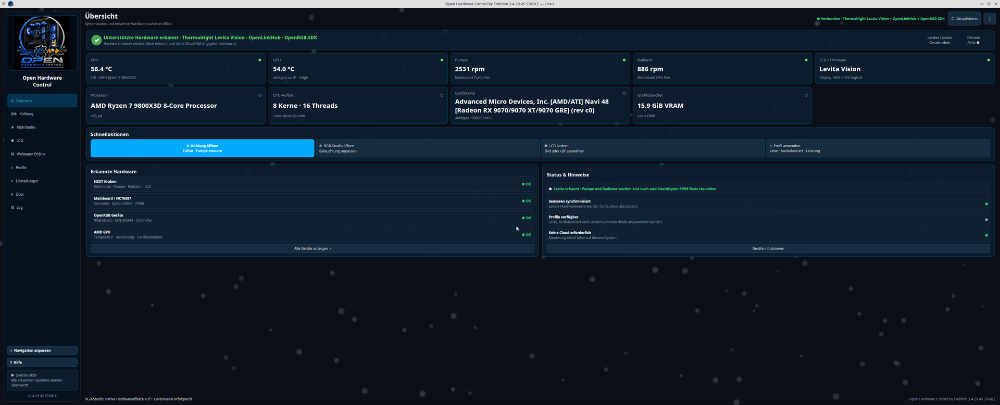
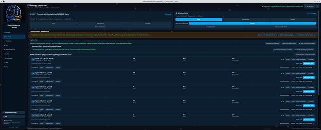
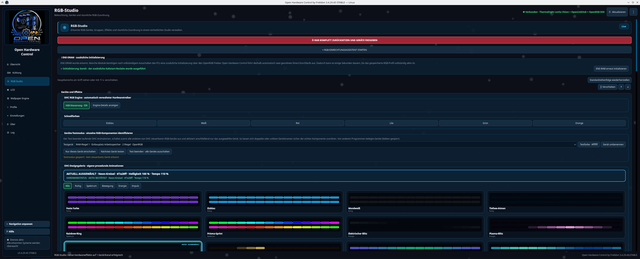
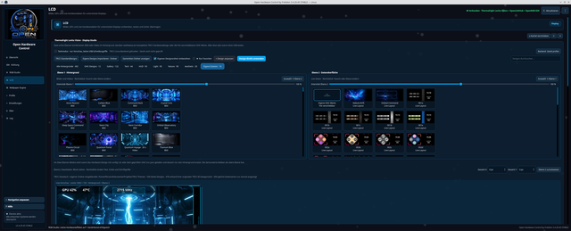
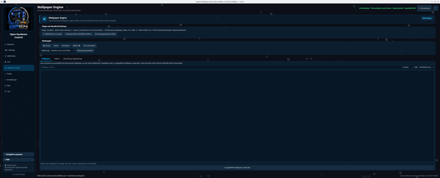
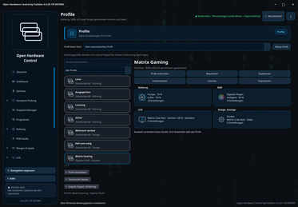
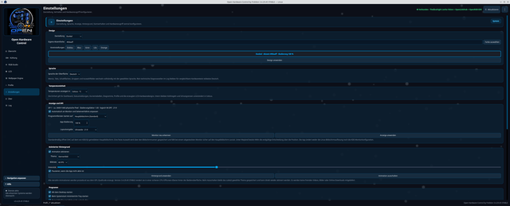

# Open Hardware Control by Frelidon 3.4.29.166 STABLE

<!-- project-badges -->
[](https://github.com/Frelidon/open-hardware-control/actions/workflows/ci.yml) [](LICENSE) [](https://github.com/Frelidon/open-hardware-control/releases)
<!-- /project-badges -->

Open Hardware Control ist eine freie Linux-Oberfläche für **NZXT-Kraken-LCD**, Pumpe, Radiatorlüfter und RGB, für das **Thermalright Levita Vision Display**, für **kalibrierte Mainboard-/Gehäuselüfter über Linux hwmon/NCT6687**, für **Corsair-Geräte über OpenLinkHub** sowie für zusätzliche RGB-Geräte über eine von OHC automatisch verwaltete lokale Hardware-Engine. Das Projekt richtet sich an Fedora, Nobara, Debian, Ubuntu, Linux Mint, Arch Linux, Manjaro, EndeavourOS und openSUSE.

<!-- project-repository -->
Projekt-Repository: <https://github.com/Frelidon/open-hardware-control>
<!-- /project-repository -->

> **Inoffizielles unabhängiges Community-Projekt:** Bisher besteht keine offizielle Unterstützung, Kooperation, Freigabe oder Verbindung zu NZXT, Corsair, Thermalright, be quiet!, OpenLinkHub, OpenRGB oder anderen genannten Herstellern und Projekten. Produkt- und Markennamen dienen nur der Kompatibilitätsbeschreibung. Hersteller und Rechteinhaber erreichen Frelidon über die öffentliche Kontaktadresse im GitHub-Profil oder über den Steam-Benutzernamen **Frelidon**.

## Screenshots

[](docs/images/screenshots/01-uebersicht.png)

<table>
  <tr>
    <td align="center" width="33%">
      <a href="docs/images/screenshots/02-kuehlung.png"></a><br>
      <sub><b>Kühlung</b> · Levita/Kraken, Gehäuselüfter, CoolerControl-Schutz</sub>
    </td>
    <td align="center" width="33%">
      <a href="docs/images/screenshots/03-rgb-studio.png"></a><br>
      <sub><b>RGB-Studio</b> · Engine, ENE-DRAM, Testmodus, Designgalerie</sub>
    </td>
    <td align="center" width="33%">
      <a href="docs/images/screenshots/04-lcd-levita.png"></a><br>
      <sub><b>LCD</b> · Thermalright-Levita-Studio mit zwei Ebenen</sub>
    </td>
  </tr>
  <tr>
    <td align="center" width="33%">
      <a href="docs/images/screenshots/05-wallpaper-engine.png"></a><br>
      <sub><b>Wallpaper Engine</b> · Steam-Workshop und Plasma-Wiedergabe</sub>
    </td>
    <td align="center" width="33%">
      <a href="docs/images/screenshots/06-profile.png"></a><br>
      <sub><b>Profile</b> · Kühlung, RGB, LCD und Design gemeinsam sichern</sub>
    </td>
    <td align="center" width="33%">
      <a href="docs/images/screenshots/07-einstellungen.png"></a><br>
      <sub><b>Einstellungen</b> · Design, Sprache, Anzeige, Autostart</sub>
    </td>
  </tr>
</table>

<sub>Klick auf ein Bild öffnet die große Ansicht. Reihenfolge wie in der Seitenleiste der App.</sub>

## Thermalright Levita Vision Display

**Das 1600×720-Display der Thermalright Levita Vision 360 ARGB Black wird unterstützt.** Das lokale Display-Studio kombiniert eigene Bilder und Videos (Ebene 1) mit einem vollständigen TRCC-Hardwaredesign oder frei verschiebbaren OHC-Live-Werten für CPU, GPU, RAM, Uhrzeit und eigenen Text (Ebene 2). Mitgeliefert werden elf eigene OHC-Hintergründe, zwölf eigene editierbare Datenlayouts, vier eigene Ebene-1-Animationen sowie fünf OHC-Effektfamilien mit zwölf Varianten. Hersteller-/TRCC-Katalogmedien, importierte Benutzerdateien, Stock-Clips und fremde Designbestandteile werden nicht mitgeliefert.

Der sichere Testmodus ist standardmäßig aktiv; echte USB-Übertragung erfolgt nur über das separat installierte GPL-Backend **TRCC Linux** (9.10.4 empfohlen). Pumpe und Radiatorlüfter der Levita laufen über getrennt bestätigte Mainboard-PWM-Header (`PUMP_FAN`, `CPU_FAN`) mit sicherem 70-%-/10-s-Test; CoolerControl blockiert parallele Schreibzugriffe.

## Neu in 3.4.29.166 STABLE

- Öffentliche Ausgabe mit vollständig bereinigtem Designkatalog: Im Repository
  und in allen Paketen liegen ausschließlich projekt-eigene OHC-Designs.
- Jeder Hauptbereich zeigt eine eigene Feature-Version und seinen Reifegrad als
  Alpha, Beta, Release Candidate oder Stabil, ohne Funktionspfade zu verändern.
- Hersteller-/TRCC-Kataloge, Stock-Medien, Kenney-Bestandteile und importierte
  Benutzerdateien sind ausdrücklich nicht Bestandteil der Veröffentlichung.
- Der vollständige Levita-UI-Release-Test läuft auf lokaler Hardware und auf
  hardwarefreien GitHub-Runnern mit demselben ausdrücklich gesetzten Testzustand.
- Eigene LCD-Medien bleiben beim Abwählen auch ohne systemweiten TRCC-Katalog
  ausgeblendet; Dateien bleiben erhalten und OHC-Designs weiterhin verfügbar.
- Der isolierte Vorschau-Kindprozess erzwingt Qt `minimal`: vollständig headless,
  mit definierter Fenstergeometrie unabhängig von der geerbten Testsuite-Umgebung.
- Der TRCC-GPU-Taktgrenzschutz verlangt drei plausible Messungen, bevor die
  dynamische Livequelle nach dem 1-MHz-Grenzfall wieder übernommen wird.

Ältere Versionen: [Versionsverlauf](#versionsverlauf) · [docs/CHANGELOG.md](docs/CHANGELOG.md) · [docs/releases/](docs/releases/)

## Installation

### Fedora und Nobara – RPM

Lade `open-hardware-control-3.4.29.166-1.noarch.rpm` in deinen Downloads-Ordner und führe aus:

```bash
cd ~/Downloads
sudo dnf install ./open-hardware-control-3.4.29.166-1.noarch.rpm
```

### Debian, Ubuntu und Linux Mint – DEB

Lade `open-hardware-control_3.4.29.166_all.deb` in deinen Downloads-Ordner und führe aus:

```bash
cd ~/Downloads
sudo apt install './open-hardware-control_3.4.29.166_all.deb'
```

### Universelles Installationspaket – ZIP

Für Fedora/Nobara, Debian/Ubuntu/Mint, Arch/Manjaro/EndeavourOS und openSUSE. Lade `open_hardware_control_v3_4_29_166.zip` herunter und führe aus:

```bash
cd ~/Downloads
unzip open_hardware_control_v3_4_29_166.zip
cd open-hardware-control-3.4.29.166
chmod +x install.sh
./install.sh
```

Eine vorhandene Version wird aktualisiert. Danach findest du **Open Hardware Control by Frelidon** im Anwendungsmenü oder startest im Terminal `~/.local/bin/open-hardware-control` (der alte Befehl `kraken-control` funktioniert weiterhin). Die Abhängigkeitsprüfung erkennt die gängigen Paketmanager automatisch; alle distributionsspezifischen Befehle stehen in [docs/INSTALL.md](docs/INSTALL.md).

Optional: **LACT** (GPU-Tuning) und **OpenRGB** (RGB-Geräte) lassen sich im Assistenten oder ihrem Bereich nach Bestätigung installieren, sofern die Paketquelle unterstützt wird. **OpenLinkHub** (Corsair), **TRCC Linux** (Levita-Display) und **CaptSilver Wallpaper-Engine-Plugin** (KDE) bleiben getrennte Komponenten; OHC liefert sie nicht mit. OpenLinkHub kann im zugehörigen Bereich nach ausdrücklicher Bestätigung aktualisiert werden.

## Sicherheit

- Schreibzugriffe nur auf passende, erkannte Geräte: Kraken über liquidctl, Corsair über eine feste, validierte Aktionsliste, Mainboard-PWM erst nach physischer Bestätigung.
- OpenLinkHub und OpenRGB werden ausschließlich über Loopback (`127.0.0.1`) angesprochen; OpenRGB nur im ausdrücklichen `--client`-Modus gegen den lokalen SDK-Server `127.0.0.1:6742`.
- RGB-/Corsair-Schreibrechte gelten nur für die aktuelle Sitzung; konkurrierende Geräte (NZXT ↔ OpenRGB, Corsair ↔ OpenLinkHub) bleiben gesperrt.
- Polkit-Freigaben speichern kein Passwort; systemweite Dienste werden nie automatisch geändert. Keine Firmwareaktualisierungen, keine Cloud, keine Telemetrie.
- Details: [.github/SECURITY.md](.github/SECURITY.md) · [docs/security/](docs/security/)

## Dokumentation

| Ordner | Inhalt |
|---|---|
| [docs/INSTALL.md](docs/INSTALL.md) · [docs/CHANGELOG.md](docs/CHANGELOG.md) | Installation je Distribution, vollständige Änderungshistorie |
| [docs/hardware/](docs/hardware/) | [Unterstützte Geräte](docs/hardware/SUPPORTED_DEVICES.md), [Profile](docs/hardware/PROFILES.md), [CPU-Profile](docs/hardware/CPU_PROFILES.md), [RGB-Studio](docs/hardware/RGB_STUDIO.md), [OpenLinkHub-Anbindung](docs/hardware/OPENLINKHUB_INTEGRATION.md), USB-Mitschnittauswertung |
| [docs/project/](docs/project/) | [Architektur](docs/project/ARCHITECTURE.md), [Projektstatus](docs/project/PROJECT_STATUS.md), [Modulregister](docs/project/MODULE_REGISTRY.md), [Projektdokumentation](docs/project/Open_Hardware_Control_Projekt.md), Roadmap, Entscheidungen |
| [docs/security/](docs/security/) | Sicherheitsaudits RGB/Desktop, [Datenschutz](docs/security/PRIVACY.md), Scan-Bericht |
| [src/](src/) | Anwendungscode: `kraken_control.py` (Einstieg), Fachmodule unter `src/modules/`, Grafiken unter `src/assets/` |
| [docs/ai/](docs/ai/) | Arbeitsanleitungen für lokale und webbasierte Coding-KIs |
| [docs/releases/](docs/releases/) | Release Notes aller Versionen, Release-Checkliste |
| [packaging/](packaging/) | `install.sh`/`uninstall.sh`, `VERSION`, `BUILD_CHANNEL`, udev-Regel, Polkit-Policy, Metainfo, Desktop-Datei, Hilfsskripte |

English version: [docs/README.en.md](docs/README.en.md)

## Status

Öffentliche stabile Version, bereitgestellt ohne Garantie. Kanal **STABLE**, Lizenz **GPL-3.0-or-later**. Mitwirken: [.github/CONTRIBUTING.md](.github/CONTRIBUTING.md) · Hilfe: [.github/SUPPORT.md](.github/SUPPORT.md) · Sicherheitsmeldungen: [.github/SECURITY.md](.github/SECURITY.md)

## Module

### NZXT Kraken 2023

RGB, Bilder, GIFs, Uhr, statische und animierte Live-Hardwaredesigns, CPU-/GPU-Livewerte, softwaregeregelte CPU-Temperaturkurven für Pumpe und Lüfter, Profile, vier Sprachen und LCD-Sicherheitsfallback. Während einer LCD-Animation bleiben Kraken-Statusabfragen pausiert; nötige Pumpen-/Lüfteränderungen laufen als kurze exklusive USB-Transaktion, danach übernimmt der Streamer wieder.

| Gerät | USB-ID | Umfang |
|---|---|---|
| NZXT Kraken 2023 | `1e71:300e` | Wasser, Pumpe, Radiatorlüfter, LCD |
| NZXT 2023 RGB Controller | `1e71:2012` | drei RGB-Kanäle |

### Thermalright Levita Vision

Display-Studio mit zwei Ebenen (siehe oben), neuer prozeduraler Rauch-Editor unter Display-Effekte, Import lokaler Bilder, Videos, `.zt`-Dateien und TRCC-Layoutordner, TRCC-Kategorien Gallery/Tech/HUD/Light/Nature/Aesthetic, Favoriten, eigener Designordner, Autostart beider Ebenen und Kühlung über bestätigte Mainboard-PWM-Header.

### Mainboard- und Gehäuselüfter

Linux hwmon/NCT6687 (z. B. MSI X870-Familie). Jeder PWM-Kanal wird erst nach einem kurzen physischen Test freigegeben; danach Leise/Ausbalanciert, ein sofortiger 100-%-Leistungsmodus, eigene Kurven, Sensorquelle, Hysterese, ein rückstellender 0-%-/10-s-Stopptest sowie PWM/DC-Umschaltung nur über vorhandenes `pwmN_mode`. Fehlt dieser Knoten, bleibt der elektrische Modus im BIOS festgelegt. Beim Beenden geht die Regelung an BIOS/Firmware zurück.

### Corsair · OpenLinkHub

Ausschließlich über die lokale API `http://127.0.0.1:27003`. Dokumentierte Schreibbefehle für Kühlung, RGB/LCD, Maus, Tastatur und Headset; Bedienfelder nur für erkannte Geräte. Benutzer- und Systemdienst werden getrennt erkannt. Die neue Versionsprüfung aktualisiert Paketinstallationen über vorhandene Quellen oder den sicheren Benutzerdienst-Pfad einschließlich Web-UI erst nach Bestätigung.

### RGB-Studio · OpenRGB-SDK

OHC startet bei Bedarf einen privaten fensterlosen OpenRGB-Prozess und nutzt nur den lokalen SDK-Endpunkt. Erkannte Geräte, Zonen, LEDs und Modi, statische Farben, native Hardwaremodi, OHC-Animationen (Direct Mode), Geräte-Testmodus, ENE-DRAM-Kaltstart-Reinitialisierung und gespeichertes Startprofil.

### Wallpaper Engine for KDE

Liest nur lokale Steam-Workshop-Metadaten, wählt Wallpaper über Plasmas offizielle Skript-Konfiguration und steuert die Wiedergabe über das lokale D-Bus-Objekt des separat installierten CaptSilver-Plugins. Der Assistent deckt Steam, Workshop, KDE-Hilfspakete und Plugin ab; auf Fedora bleibt der RPM-Download SHA256-geprüft und verlangt vor Polkit/DNF eine zweite Zustimmung.

## Versionsverlauf

**3.4.29.166** – Öffentliche Ausgabe mit OHC-eigenen Designs, Feature-Reifegraden, robuster LCD-Medienauswahl und zeitunabhängigem Vorschautest.

**3.4.29.159** – Veröffentlichungskandidat mit OHC-eigenem Designkatalog und Feature-Reifegraden.

**3.4.29.158** – OpenRGB-Profilmeldungen korrekt synchronisiert und GPU-Taktgrenzschutz stabilisiert.

**3.4.29.157** – Programme/Profile, vollständige GitHub-Downloads und automatische Wiederherstellung des eigenen Levita-Daemons.

Alle früheren Versionen bis 2.9.x: [docs/CHANGELOG.md](docs/CHANGELOG.md) und [docs/releases/](docs/releases/).
